<a href="https://portfolio-7ug.pages.dev/">
  
</a>

 

I build software people **rely on**, and I care about it long after launch. Over the past four years I've built and contributed to full-stack and edge-deployed systems across **public-sector**, **health**, and **commercial** products, from national infrastructure used every day to apps serving users around the world.

I'm happiest when the problem is ambiguous, the stakes are real, and the goal is something that keeps working long after it ships.

 


  


<table>
  <tr>
    <td width="50%"><a href="https://qura.co.ke"></a></td>
    <td width="50%"></td>
  </tr>
  <tr>
    <td width="50%"><a href="https://ploracs.com"></a></td>
    <td width="50%"><a href="https://statistics.nakuru.go.ke"></a></td>
  </tr>
  <tr>
    <td width="50%"><a href="https://portfolio-7ug.pages.dev/#projects"></a></td>
    <td width="50%"><a href="https://portfolio-7ug.pages.dev/#projects"></a></td>
  </tr>
</table>

<a href="https://portfolio-7ug.pages.dev/#projects">more on the portfolio →</a>



Tools change; the way I choose them doesn't. These are what I reach for lately, not where I stop.

  

  


  
  &nbsp;
  
  &nbsp;
  

<!-- Assets are generated by scripts/generate.py — edit the content there and re-run. -->
