Full-stack engineer in Kenya. I've worked on public-sector and health systems, including Kenya's national child protection system (CPIMS), along with products of my own.

<table>
  <tr>
    <td width="50%"></td>
    <td width="50%"></td>
  </tr>
  <tr>
    <td width="50%"></td>
    <td width="50%"></td>
  </tr>
  <tr>
    <td width="50%"></td>
    <td width="50%"></td>
  </tr>
</table>

**Also worked on**

- **CPIMS**: the Android app for Kenya's national child protection system, used by social workers in the field.
- **Pona**: a WebRTC server for doctor–patient video calls, plus the React app around it.

  

  

  

  
  &nbsp;
  
  &nbsp;
  

